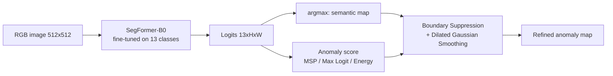

# Semantic Segmentation of Unexpected Objects on Roads

**Anomaly segmentation on StreetHazards using a SegFormer backbone with post-hoc OOD scoring (MSP, Max Logit, Energy) and Boundary Suppression.**

Project for the *Machine Learning for Computer Vision* (ML4CV) course, University of Bologna — Armando Renzullo.

---

## Overview

Autonomous-driving perception models are trained on a closed set of classes, yet on real roads they meet objects they have never seen: debris, animals, overturned vehicles. A standard segmenter will confidently assign those pixels to one of the known classes. This project tackles **open-set semantic segmentation**: segment the known classes *and* produce a per-pixel **anomaly score** that highlights unexpected objects.

The approach is two-stage and fully **post-hoc**, so no outlier data is needed during training:

1. **Closed-set segmenter**: a SegFormer-B0 fine-tuned on the 13 known StreetHazards classes.
2. **Anomaly scoring**: per-pixel scores computed from the segmenter's output (MSP, Max Logit, Energy), refined with **Boundary Suppression + Dilated Smoothing** to remove false positives along class edges.



### Key results (test set)

| Metric | Value |
|---|---|
| Segmentation mIoU (13 known classes) | **50.95%** |
| Anomaly AUPR, MSP baseline | 7.93% |
| Anomaly AUPR, **best: Energy (T = 2.0) + Boundary Suppression** | **14.05%** (+6.12 pts vs. MSP, ~1.8×) |

---

## Repository structure

```
.
├── main.ipynb                 # Full pipeline: data, training, evaluation, anomaly detection
├── test_results.csv           # Test results: MSP, Max Logit, Max Logit + BS
├── energy_grid_search.csv     # Energy grid search: T ∈ {0.5, 1.0}, BW ∈ {4, 6}
├── energy_grid_high_t.csv     # Energy grid search: T ∈ {1.0, 1.2, 1.5, 2.0}, BW = 4
├── energy_grid_high_t_2.csv   # Energy grid search: T ∈ {2.5, 3, 3.5, 5, 6, 8, 10}, BW = 4
└── README.md
```

All code lives in `main.ipynb`, which is saved with its outputs: results, training curves and qualitative figures are visible directly on GitHub. The CSV files hold the raw evaluation results reported below.

---

## Dataset: StreetHazards

[StreetHazards](https://github.com/hendrycks/anomaly-seg) is a synthetic urban-driving dataset rendered with the CARLA simulator and built for anomaly segmentation.

| Split | Images | Notes |
|---|---|---|
| Train | 5,125 | 12 semantic classes + *unlabeled* |
| Validation | 1,031 | same classes as training |
| Test | 1,500 | adds a 14th class, **anomaly**, never seen during training |

Images are 1280×720. The 13 known classes are: *unlabeled, building, fence, other, pedestrian, pole, road line, road, sidewalk, vegetation, car, wall, traffic sign*.

The class distribution is heavily **imbalanced**. Fence, other, pedestrian, pole, road line, car, wall and traffic sign are under-represented in every split, and this drives several of the design choices below.

The notebook downloads and extracts the dataset automatically (~8.7 GB train + ~2 GB test).

---

## Methodology

### 1. Segmentation backbone

| Component | Choice |
|---|---|
| Architecture | **SegFormer-B0** (hierarchical Transformer encoder + lightweight all-MLP decoder) |
| Initialization | `nvidia/segformer-b0-finetuned-ade-512-512` (Hugging Face), with the classifier head re-initialized for 13 classes |
| Framework | PyTorch Lightning |
| Input resolution | 512 × 512, ImageNet normalization |
| Optimizer | AdamW, weight decay 0.1, cosine annealing |
| Discriminative LRs | decoder head `1e-4`, encoder `1e-5` |
| Backbone freezing | encoder frozen for the first 5 epochs to warm up the head |
| Training | batch 8, mixed precision (fp16), max 25 epochs, early stopping on val mIoU (patience 5), best checkpoint on val mIoU |
| Hardware | Google Colab, NVIDIA T4 |

**Data augmentation** (training only): random scaling (±25%), horizontal flip (p = 0.5), random rotation (±15°), color jitter (brightness/contrast/saturation 0.2, hue 0.02). Images use bilinear interpolation; masks use nearest-neighbor so that no fake classes appear at object boundaries.

#### Three training runs

| Run | Loss | Class-imbalance handling |
|---|---|---|
| `no_dice` | Cross-Entropy | none |
| `dice` | Cross-Entropy + **Dice** | none |
| `reweight` | **Weighted** Cross-Entropy + Dice | class weights (×2 fence, other, car, wall, traffic sign; ×3 pedestrian, pole) + **rare-class cropping** (p = 0.3, crop centered on a pixel of a rare class) |

### 2. Anomaly scoring

All scores are computed per pixel from the logits $z \in \mathbb{R}^{13}$ of the best segmenter (`reweight`):

| Method | Anomaly score | Reference |
|---|---|---|
| **Maximum Softmax Probability (MSP)** | $1 - \max_k \text{softmax}(z)_k$ | Hendrycks & Gimpel, ICLR 2017 |
| **Max Logit (ML)** | $-\max_k z_k$ | Hendrycks et al., ICML 2022 |
| **Energy** | $E(x) = -T \log \sum_k e^{z_k / T}$ | Liu et al., NeurIPS 2020 |

MSP suffers from *softmax compression*: normalization pushes even anomalous pixels toward high confidence. Max Logit and Energy work on the unnormalized logits and keep the magnitude information that separates known from unknown pixels. The temperature $T$ in the energy score controls how smooth the energy surface is.

### 3. Boundary Suppression + Dilated Smoothing (BS)

Adapted from *Standardized Max Logits* (Jung et al., ICCV 2021). Segmenters are naturally uncertain on the edges between two known classes (e.g. car/road), which produces thin lines of false-positive anomalies. The module:

1. **Finds semantic boundaries** in the predicted map (dilation ≠ erosion).
2. **Iteratively suppresses** them, replacing boundary scores with the average of neighboring non-boundary pixels (boundary width 4, 4 iterations).
3. **Applies dilated Gaussian smoothing** (7×7 kernel, σ = 1, dilation 6) to enforce spatial coherence and remove isolated noisy pixels.

### 4. Evaluation metrics

- **mIoU** over the 13 known classes, with anomaly pixels excluded.
- **AUPR** (Area Under the Precision-Recall curve), with anomaly pixels as the positive class, computed per image and averaged over the test set.

---

## Results

### Segmentation (validation set)

| Run | Best val mIoU | Epochs trained |
|---|---|---|
| CE only (`no_dice`) | 50.67% | 25 |
| CE + Dice (`dice`) | 53.70% | 21 (early stopped) |
| **Weighted CE + Dice + rare-class crop (`reweight`)** | **54.56%** | 21 (early stopped) |

- Adding the **Dice loss** gives the largest gain (+3 pts mIoU) and reduces overfitting. Qualitatively, it is the first model that correctly segments pedestrians.
- **Re-weighting + rare-class cropping** adds a further +0.9 pts and overfits slightly less, but cannot fully make up for how few pixels the minority classes have.

### Segmentation (test set, `reweight` model)

| Class | IoU | Class | IoU |
|---|---|---|---|
| Road | 94.76 | Car | 60.82 |
| Unlabeled | 86.17 | Road line | 53.85 |
| Vegetation | 82.12 | Wall | 37.70 |
| Building | 72.32 | Fence | 30.32 |
| Sidewalk | 65.51 | Traffic sign | 29.05 |
| | | Pole | 26.15 |
| | | Other | 23.61 |
| | | Pedestrian | 0.00 |
| **Mean IoU** | **50.95** | | |

Large "stuff" classes (road, vegetation, building) are segmented well. Thin and rare "thing" classes (pole, traffic sign, fence, pedestrian) remain the main weakness.

### Anomaly detection (test set)

| Method | AUPR (%) |
|---|---|
| MSP | 7.93 |
| Max Logit | 10.85 |
| Max Logit + BS | 13.16 |
| Energy (T = 1.0) + BS | 13.55 |
| **Energy (T = 2.0) + BS** | **14.05** |

- **Max Logit > MSP** (+2.9 pts): removing softmax normalization keeps the logit magnitude, which separates known from unknown pixels.
- **Boundary Suppression** is the single most effective refinement (+2.3 pts on Max Logit), because it removes thousands of false positives along object edges. All later experiments use it.
- **Energy** with a tuned temperature gives the best overall result.

#### Energy hyperparameter search (BS enabled)

| T | BW = 4 | BW = 6 |
|---|---|---|
| 0.5 | 13.29 | 13.29 |
| 1.0 | 13.55 | 13.52 |
| 1.2 | 13.67 | |
| 1.5 | 13.86 | |
| **2.0** | **14.05** | |
| 2.5 | 13.97 | |
| 3.0 | 13.51 | |
| 3.5 | 12.64 | |
| 5.0 | 8.72 | |
| 6.0 | 6.25 | |
| 8.0 | 3.28 | |
| 10.0 | 2.15 | |

AUPR rises steadily from T = 0.5 to a peak at **T = 2.0**, then drops sharply. A moderate temperature smooths extreme logit values (often found at boundaries and in noisy pixels) without washing out the contrast between known and unknown objects. A larger boundary width (BW = 6) brings no benefit.

---

## Reproducing the results

> **Note:** the trained weights and training logs are not distributed with this repository. `main.ipynb` is saved with all of its outputs, so every table, training curve and qualitative figure reported here can be viewed directly on GitHub without running anything.

To reproduce the experiments from scratch you need **Google Colab with a GPU runtime** (the original runs used an NVIDIA T4). The Boundary Suppression module allocates its kernels directly on CUDA, so a CPU-only runtime will not work.

### Execution flags

The first code cell defines two flags, both `False` by default:

| Flag | `True` | `False` |
|---|---|---|
| `TRAIN` | trains the three SegFormer runs and saves the checkpoints and CSV logs to Google Drive | loads the checkpoints from Google Drive |
| `EVALUATE` | recomputes the per-class analysis, the test metrics and the energy grid searches (slow) | loads the results from the CSV files |

### Steps

1. **Open the notebook** in Colab (*File → Open notebook → GitHub*, or upload `main.ipynb`) and select a GPU runtime (*Runtime → Change runtime type → T4 GPU*).
2. **Train:** set `TRAIN = True` and run all cells. The notebook mounts Google Drive and downloads StreetHazards automatically (~11 GB). The best checkpoint of each run and its CSV logs are saved to `MyDrive/weights/`.
3. **Evaluate:** set `TRAIN = False` and `EVALUATE = True`, then run all cells again. The checkpoints are now loaded from Drive (the `reweight` model, used for anomaly detection, is loaded only in this mode). The test metrics and grid searches are recomputed and saved as CSV files to `MyDrive/ml4cv-assignment-master/`.

### Notes

- **Paths are hard-coded for Colab and Google Drive:** checkpoints and logs go in `/content/drive/MyDrive/weights`, result CSVs in `/content/drive/MyDrive/ml4cv-assignment-master/`. To view the result tables of this repository with `EVALUATE = False`, copy the CSV files into that folder.
- **Training-curve cells read logs from fixed folders** (`lightning_logs/version_0`, and `version_17` for the Dice run). A fresh training creates `version_0`, so update the Dice-run path accordingly.
- A fixed seed (`SEED = 7`) is used, but GPU non-determinism can make results differ slightly from the reported ones.

### Dependencies

Colab provides everything except `lightning` and `kornia`, which the notebook installs itself:

`torch`, `torchvision`, `transformers`, `lightning`, `kornia`, `scikit-learn`, `scipy`, `numpy`, `pandas`, `matplotlib`, `Pillow`, `tqdm`

---

## Limitations and future work

- **Rare classes** (pedestrian, pole, traffic sign) are still poorly segmented. Stronger rebalancing (e.g. focal loss, OHEM) or a larger backbone (SegFormer-B2/B5) would likely help, and better segmentation also produces cleaner anomaly scores.
- **Hyperparameters of the anomaly detector** (T, BW) were selected on the test split. A held-out anomaly validation set would give an unbiased estimate.
- **AUPR is averaged per image** rather than computed over all test pixels at once, so the numbers are not directly comparable with values reported in the literature.
- Purely post-hoc methods are limited by the closed-set segmenter. **Outlier exposure** or **SML standardization** of the logits are natural next steps.

---

## References

- Hendrycks, D., et al. *Scaling Out-of-Distribution Detection for Real-World Settings.* ICML 2022. (StreetHazards dataset, Max Logit)
- Hendrycks, D., & Gimpel, K. *A Baseline for Detecting Misclassified and Out-of-Distribution Examples in Neural Networks.* ICLR 2017. (MSP)
- Liu, W., Wang, X., Owens, J., & Li, Y. *Energy-based Out-of-distribution Detection.* NeurIPS 2020.
- Jung, S., Lee, J., Gwak, D., Choi, S., & Choo, J. *Standardized Max Logits: A Simple yet Effective Approach for Identifying Unexpected Road Obstacles in Urban-Scene Segmentation.* ICCV 2021. (Boundary Suppression)
- Xie, E., et al. *SegFormer: Simple and Efficient Design for Semantic Segmentation with Transformers.* NeurIPS 2021.
- Milletari, F., Navab, N., & Ahmadi, S.-A. *V-Net: Fully Convolutional Neural Networks for Volumetric Medical Image Segmentation.* 3DV 2016. (Dice loss)
